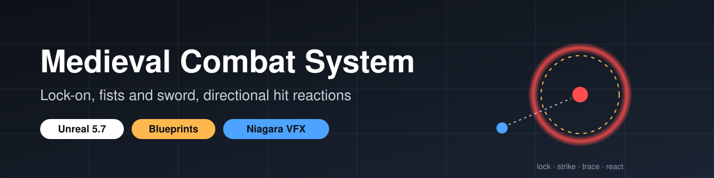
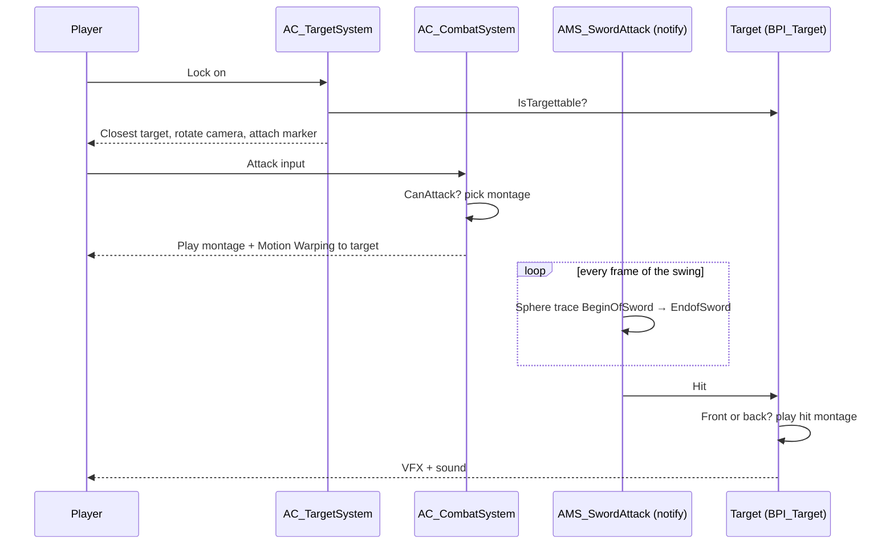
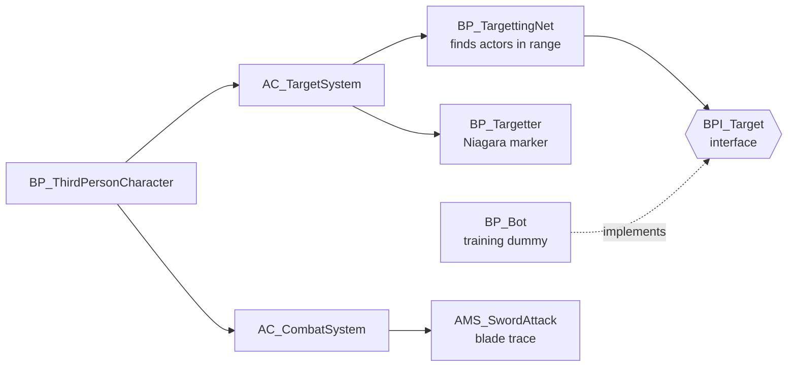

<p align="center">
  
</p>

<p align="center">
  <a href="https://www.ibrahimenescolak.com"><b>Portfolio</b></a> ·
  <a href="https://www.linkedin.com/in/ibrahim-enes-%C3%A7olak">LinkedIn</a> ·
  <a href="https://qpayk.itch.io">itch.io</a>
</p>

# UE5 Medieval Combat System

Player-side melee combat for Unreal Engine 5.7, built in Blueprints: a lock-on target system, unarmed and sword attacks, a sword hit trace driven by an Anim Notify State, and front/back hit reactions on the target. There is no enemy AI here; the bot is a target dummy that takes hits.

<!-- MEDIA: put a 10–15 s GIF here once recorded, e.g.
<p align="center"></p>
-->

## What it does

| Area | What is in the project |
|---|---|
| **Lock-on** | `AC_TargetSystem` (an Actor Component on the player) asks `BP_TargettingNet` for every overlapping actor that implements `BPI_Target` and says it is targettable, then picks the closest one. While locked, the control rotation turns towards the target with `FindLookAtRotation`. |
| **Target marker** | `BP_Targetter` is spawned and attached to the current target, showing a Niagara glow so you can see who is locked. |
| **Targettable actors** | Any actor can join the system by implementing the `BPI_Target` interface (`IsTargettable`, `IsCombatTargettable`); the player code never checks for a specific class. |
| **Two combat modes** | `E` toggles between fists and sword (a Flip Flop on the input), and each mode has its own attack montages. |
| **Attacks** | `AC_CombatSystem` holds the attack montage lists (punches and sword combos) and a `CanAttack` gate so a new attack can't start in the middle of another. Motion Warping turns the player towards the target. |
| **Sword hit detection** | `AMS_SwordAttack` is an Anim Notify State: during the swing it sphere-traces every frame between the `BeginOfSword` and `EndofSword` sockets, so hits follow the blade, not a fixed box. |
| **Hit reactions** | The target plays a front or back hit montage depending on which side it was hit from. |
| **Feedback** | Niagara effects and hit sounds on impact. |

## How a sword hit works



## How the pieces fit



## Project layout

```
Content/
├── CombatSystem/
│   ├── Components/   AC_TargetSystem, AC_CombatSystem
│   ├── Actor/        BP_TargettingNet, BP_Targetter
│   ├── Interfaces/   BPI_Target
│   ├── Notify/       AMS_SwordAttack
│   └── Bot/          BP_Bot (training dummy), AI_Bot
├── ThirdPerson/      BP_ThirdPersonCharacter, Lvl_ThirdPerson (open this map)
└── Input/            IA_Move, IA_Look, IA_Jump, IA_Attack
```

## Running it

1. Install **Unreal Engine 5.7** and clone the repo.
2. Add the Epic mannequins: in the editor use **Add → Add Feature or Content Pack → Third Person**, or copy `Content/Characters/Mannequins` from any UE 5.7 Third Person project.
3. The sword, animations, sounds and VFX come from third-party Fab packs whose licences do not allow sharing them, so they are **not in this repo** (the full list of folders is in `.gitignore`). Without them the project opens and every Blueprint can be read, but montages, the sword mesh and effects show up as missing references.
4. Open `New_Version_Combat.uproject`, then `Content/ThirdPerson/Lvl_ThirdPerson`, and press **Play**.

| Input | Action |
|---|---|
| WASD / mouse | Move / look |
| Left mouse | Attack (punch or sword, depending on the current mode) |
| E | Switch between fists and sword |
| Space | Jump |

## What I would improve next

- Enemy AI that fights back (my [UE5-Boxer-Enemy-AI](https://github.com/ibrahim0enes/UE5-Boxer-Enemy-AI) is a first step).
- Plug the hits into my C++ [UE5-Health-Damage-System](https://github.com/ibrahim0enes/UE5-Health-Damage-System) instead of handling damage in Blueprints.
- Switch targets with the mouse while locked on.
- Replication for multiplayer.

## My other UE5 repos

| Repo | What it is |
|---|---|
| [UE5-Boxer-Enemy-AI](https://github.com/ibrahim0enes/UE5-Boxer-Enemy-AI) | Boxer enemy that chases, punches and reacts, built in Blueprints without a Behavior Tree |
| [UE5-Health-Damage-System](https://github.com/ibrahim0enes/UE5-Health-Damage-System) | Reusable health and damage component in C++ (interface, delegates, Blueprint hooks) |
| [UE5-Medieval-Combat-System](https://github.com/ibrahim0enes/UE5-Medieval-Combat-System) | Player-side medieval combat: lock-on, fists and sword, directional hit reactions |

## Credits

- Code and Blueprints: İbrahim Enes Çolak
- Sword, animations, sounds and VFX: third-party Fab packs (not included)
- Mannequins, level prototyping and template content: Epic Games, Unreal Engine Third Person template
